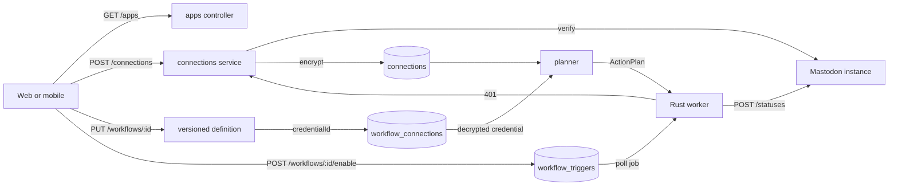

# ADR 0011 — Connections API and the Mastodon app

- Status: **Accepted**
- Date: 2026-11-24
- Deciders: @alejandrolaguna20 @gerardPolloRebozado

## Context

The catalogue (`AppDefinition`), the encrypted `Connection` table, the
`WorkflowConnection` join table and `OAuthState` were already in the schema, but no
route wrote any of them. Both clients rendered hardcoded service lists and fake
"needs reconnecting" banners. A second provider was needed to prove the connector
abstraction generalises beyond Gmail, and the Builder needed a real save path or the
whole thing stayed a simulation.

Mastodon was chosen over GitHub, Slack and Gmail: every account lives on a different
instance, so the base URL has to be per-connection rather than a constant in the app
definition; a personal access token works locally without an OAuth callback or a deep
link on mobile; and both a polling trigger and an action can be expressed with plain
JSON HTTP calls.

## Decision

- `GET /apps` serialises the code catalogue: id, name, auth fields, trigger names and
  action names, plus the input fields each trigger/action declares. Functions never
  leave the process.
- `GET/POST /connections`, `POST /connections/:id/test` and `DELETE /connections/:id`
  are the only credential-write routes. Credentials are encrypted with AES-256-GCM
  before insert and decrypted only when a plan or a verification call is built.
- Verification is an app concern: `AppDefinition.verify?` derives the external
  account id, the display name and the scopes from a credentials map. Mastodon uses
  `verify_credentials` and `apps/verify_credentials`.
- The external account id includes the instance host, because one `mastodon` app
  definition covers every instance and `(userId, appId, externalAccountId)` is unique.
- Disconnect and `auth_expired` both mark the connection non-active and disable the
  triggers that use it. A workflow that loses a credential becomes `error` with a real
  reason, so the UI no longer has to invent a banner.
- Workflow creation, versioned save, enable, disable, delete and manual run are real
  routes. Saving inserts an immutable `WorkflowVersion` and rebuilds
  `WorkflowConnection` rows from each node's `credentialId`.
- The Rust executor is unchanged except for rate-limit backoff: it now reads
  `X-RateLimit-Reset` when `Retry-After` is absent. Node inputs are baked into the
  plan by TypeScript; `{{ }}` in the worker only references earlier calls' outputs.
- `Idempotency-Key` is `<runId>:<nodeId>`. Mastodon honours it for one hour, which
  closes the at-least-once duplicate-post window for this connector specifically.
- Instance URLs must be https and public unless `ALLOW_PRIVATE_EGRESS=1` is set, so a
  user-supplied base URL does not turn the API into an open proxy into private networks.

## Alternatives rejected

- **A GitHub connector first.** It proves little: a fixed API host, a token in a
  header and a familiar webhook. Mastodon forces per-connection endpoints, which is
  the case the schema was built for.
- **OAuth before token.** Dynamic app registration per instance exists, but a
  callback URL and a mobile deep link add infrastructure without proving the
  planner/executor path. `OAuthState.connect` remains available for that phase.
- **Hard delete on disconnect.** It would erase run history and leave dangling
  references. `revoked` keeps the audit trail and makes the UI honest.
- **Worker-side credential lookup.** The worker has no Postgres access by design in
  [ADR 0010](./0010-step-queue.md). Credentials cross the internal HTTP boundary
  inside the plan and never enter Redis, `RunStep.inputs` or logs.

## Consequences

### Positive

- Services, Workflows, Builder and Runs are driven by the API on both clients.
- Enabling a workflow validates that its connections exist, belong to the user, match
  the app and are active, instead of failing halfway through a run.
- A rejected token is reflected in the connection row and stops dependent triggers.

### Negative

- A token pasted into the UI is long-lived; expiry only becomes visible after a 401.
- Media upload uses `multipart/form-data` and is not supported by the JSON executor.
- More than 80 notifications between two polls can be missed with `since_id`.
- DNS rebinding is not prevented: the host is validated once at connect time, not on
  every request.

## Failure table

| If this changes | This fails |
|---|---|
| `credentials.instanceUrl` moves out of the encrypted blob | every Mastodon call builds the wrong host and account uniqueness collapses across instances |
| `Idempotency-Key` drops `runId` | retries publish duplicate statuses |
| `map()` advances the cursor before filtering | notifications are dropped when more than one poll is in flight |
| `verify()` stops running on connect | bad tokens are stored as `active` and the UI lies |
| Rust stops mapping `401` to `auth_expired` | connections never leave `active`; the reconnect state never appears |
| `GET /apps` serialises a whole `AppDefinition` | functions and `dynamicChoices` leak into JSON and the generated clients break |
| Saving no longer rebuilds `workflow_connections` | revoking a connection cannot find the workflows it disabled |
| `local.properties` base URL changes | mobile requests fail exactly like the earlier login bug |
