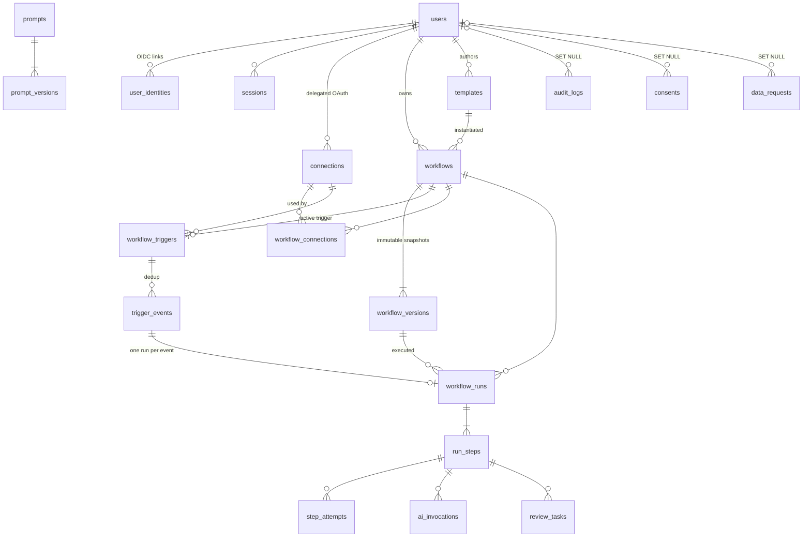

# Persistence model

This document describes how Surface Volume stores its data. The source of truth is [`packages/backend-nestjs/prisma/schema.prisma`](../packages/backend-nestjs/prisma/schema.prisma). The first migration is [`prisma/migrations/20261116000000_init`](../packages/backend-nestjs/prisma/migrations/20261116000000_init/migration.sql). Why the design looks like this: [ADR 0003](adr/0003-postgresql-database.md) (PostgreSQL + JSONB), [ADR 0006](adr/0006-orm.md) (Prisma) and [ADR 0007](adr/0007-workflow-versioned-jsonb.md) (versioned JSONB workflows, UUID keys).

The schema covers the common base and every catalogue feature that needs storage. A feature we do not deliver leaves its tables empty. That costs nothing, and it avoids a migration later.

## Conventions

| Rule | Why |
|---|---|
| UUIDv7 primary keys, generated by the Prisma client | Ids are opaque in the public API (no row counts leaked) and time-ordered, so B-tree inserts stay cheap. Raw SQL inserts must supply the id. |
| snake_case in SQL, camelCase in the Prisma client (`@map` / `@@map`) | Readable SQL for psql/debugging, idiomatic TS in code. |
| `timestamptz` everywhere | Users and workers run in different timezones. |
| `*_enc` = AES-256-GCM ciphertext + `key_version` | SEC-CRYPTO. Keys live outside the DB (Key Vault / env, SYS-SECRETS). `key_version` allows rotation without downtime: decrypt with the old key, re-encrypt with the new one. |
| `*_hash` = SHA-256 of a one-time secret | Refresh tokens, verification codes, recovery codes. A DB dump never contains a usable secret. |
| JSONB is validated **before** insert | Postgres does not check what is inside a JSONB column. Every JSON column has a Zod schema at the API/domain boundary (ADR 0003). |
| The service catalogue is **code, not data** | `AppDefinition`s (`src/workflow/`) are declared in TS. Rows reference them by string key (`app_id`, `trigger_key`, `action_key`). `/about.json`-style discovery reads the code registry. |

## Entity overview



## Tables by domain

### 1. Identity & authentication: *who the user is*

| Table | Purpose |
|---|---|
| `users` | Account. `email`/`username` are `citext` (case-insensitive unique). `password_hash` is null for OIDC-only accounts. `status` = `pending` until the email is confirmed. `preferences` (JSONB) holds UI settings: theme, density, reduce motion, notification toggles. |
| `user_identities` | Links a local user to an OIDC identity. Unique `(provider, subject)`, where `subject` is the provider's stable `sub` claim, never the email. |
| `verification_tokens` | Email confirmation code, password reset, email change. Hashed, expiring, single use (`consumed_at`), with an `attempts` counter against brute force. |
| `sessions` | Refresh-token sessions. Each refresh rotates the token (`replaced_by_id`). Presenting a token that was already rotated revokes the whole `family_id`, because it means the token was stolen. Also backs the "Active sessions" screen. |
| `mfa_factors`, `mfa_recovery_codes` | TOTP (secret encrypted) and hashed recovery codes (SEC-AUTH). |
| `login_attempts` | Sliding window for lockout and rate limiting, by identifier and by IP. |

**Linking external identities.**
- On OIDC login, look up `(provider, sub)`. If found, sign that user in.
- If not found and the provider says the email is verified, offer to link it to the local account with that email. Linking requires signing in to that account first; it is never automatic. Otherwise create a new user.
- One user can have several identities. Unlinking the last identity is refused unless the user has a password.

### 2. Connections: *what the app may do on the user's behalf*

| Table | Purpose |
|---|---|
| `connections` | A user's authorization for one service account (`AppCredential` in code). Tokens are stored only in `credentials_enc`. Unique `(user_id, app_id, external_account_id)`, so a user can connect two GitHub accounts but not the same one twice. |
| `oauth_states` | `state` + PKCE `code_verifier` for an in-flight OIDC login (`purpose=login`) or OAuth connect (`purpose=connect`). They live about 10 minutes. They are stored in Postgres because there is no Redis (ADR 0005). |

**Lifecycle of delegated credentials.**
1. **Grant.** The OAuth callback validates `oauth_states`, exchanges the code, then encrypts the tokens and inserts or updates `connections` (`status=active`, `expires_at`, `scopes`). An `audit_logs` row records `connection.grant`.
2. **Refresh.** A scheduled job selects `status='active' AND expires_at < now() + 10 min` (index `(status, expires_at)`) and calls `AuthDefinition.refresh`. Workers also refresh lazily when an action fails with `auth_expired`.
3. **Failure.** If the refresh token is rejected, the connection is set to `status=expired`. All workflows in `workflow_connections` for it go to `status=error` with `status_reason`, which drives the "Reconnect X" banner.
4. **Revoke/delete.** In one transaction: call the provider's revoke endpoint (best effort), flag the dependent workflows, delete the row, and write an audit entry.

### 3. Workflows

| Table | Purpose |
|---|---|
| `workflows` | Owner, name, status (`draft/on/off/error`), and two pointers: `latest_version_id` (what the builder shows) and `active_version_id` (what hooks execute). |
| `workflow_versions` | **Immutable** snapshot `{trigger, nodes[], links[]}` matching `src/workflow/workflow.types.ts`. Every save inserts `version = max + 1`. A DB trigger refuses `UPDATE`. |
| `workflow_triggers` | Projection of the active version's trigger node, for the hook engine: type, schedule, `next_run_at`, webhook token/secret, external subscription id, polling `cursor`, and a lease for multi-worker claiming. One per workflow. |
| `workflow_connections` | Every connection referenced by the active version (trigger and action nodes), so revocation can find dependent workflows through a real foreign key. |
| `connector_store` | Key/value state for connectors (`RunContext.store`), scoped per workflow and node. |

**Saving.** In one transaction: Zod-validate the definition, check the graph rules, check every `{{ key.path }}` against the `outputFields` declared upstream, insert the `workflow_versions` row, and move `latest_version_id`. Graph rules: a linear chain, at most one condition, two branches that never merge. There is **no maximum on the node count**: `nodes` is an array.

**Activating** (turning on, or saving while on). In one transaction:
- move `active_version_id`
- upsert `workflow_triggers` from the trigger node
- rebuild `workflow_connections`
- set `enabled=true`

A webhook trigger then calls the provider's `subscribe` outside the transaction and stores `external_subscription_id`. If that call fails, the trigger stays disabled and the workflow goes to `error`. Turning off sets `enabled=false` and unsubscribes.

### 4. Hooks and deduplication

`trigger_events` holds one row per occurrence a hook detected. **Unique `(trigger_id, external_id)`** is the guarantee that one occurrence is never processed as a new event twice:

```sql
INSERT INTO trigger_events (id, trigger_id, external_id, payload, occurred_at)
VALUES ($1, $2, $3, $4, $5)
ON CONFLICT (trigger_id, external_id) DO NOTHING
RETURNING id;   -- no row returned => already seen, do not start a run
```

- `external_id` is the connector's `TriggerEvent.id`: a message id, a file id, or an issue id plus `updated_at` when updates count as new events. When the provider gives no id, it is a SHA-256 of the canonicalized payload.
- **Polling** triggers also keep a `cursor` (high-water mark) so they ask only for newer items. Dedup protects against the overlap windows that cursors always have.
- **Scheduling.** Workers claim due triggers with `SELECT … WHERE enabled AND next_run_at <= now() ORDER BY next_run_at LIMIT n FOR UPDATE SKIP LOCKED`, which uses the partial index `workflow_triggers_due_idx`. They set `lease_until`, poll, then advance `next_run_at`. After a run of `consecutive_failures`, the trigger backs off and finally disables itself.
- **Webhooks** are routed by the unguessable `webhook_token` in the URL. The signature is checked with `webhook_secret_enc` before anything is stored.
- **Retention.** A daily job sets `payload = NULL` on events older than 30 days. The dedup key stays, so an old event that comes back is still recognized.

### 5. Runs and steps

| Table | Purpose |
|---|---|
| `workflow_runs` | One execution. It points at the exact `version_id` that ran, so editing a workflow never rewrites history. `trigger_event_id` is unique: one live run per event. `user_id` is denormalized for the cross-workflow Runs screen (index `(user_id, queued_at desc)`). |
| `run_steps` | What each node did: resolved `inputs` (secrets redacted), published `outputs`, condition decision (`branch_taken`, `condition_eval`), error kind (mirrors `ActionError.kind`). Unique `(run_id, node_id)`. Nodes the run never reached are recorded as `not_reached`, which drives the replay view. |
| `step_attempts` | Retry history with backoff (`retry_after`). |
| `idempotency_keys` | `Idempotency-Key` header on mutating endpoints ("Run now", "Retry this run"): the same key returns the stored response. |

**Failure semantics as stored.**
- `ActionError` kinds:
  - `retryable` and `rate_limited` → a new `step_attempts` row, the step stays `running` until `retry_after`.
  - `fatal` → step `failed`, run `failed`, `error_node_id` set.
  - `auth_expired` → same as fatal, and the connection is flagged.
- **Retry of a failed run** creates a new run with `mode=retry` and `retry_of_run_id`, on the same `trigger_event` payload. It copies the `succeeded` steps' outputs instead of executing them again, so side effects already done are not repeated.
- **Missing values at runtime**: the policy is decided in the engine. The step records exactly what it received in `inputs`, so the decision can always be inspected.

**Durability (ENG-ASYNC).** The run row is committed (`status=queued`) **before** the job is pushed to the queue. Workers set `lease_until` while running. A sweeper uses the partial index `workflow_runs_inflight_idx` to re-enqueue `queued`/`running` runs whose lease expired. If the queue loses a job or a worker crashes, the run is delayed, not lost.

### 6. Templates (ENG-TEMPLATES)

`templates` stores a definition with **all `credentialId`s stripped**, `required_apps` (GIN-indexed, for "templates I can use with my connections"), localized `title`/`description` (`{"en": …, "fr": …}`), `visibility`, and an optional `share_token` for unlisted links. Using a template creates a `draft` workflow with version 1 and `template_id` set. The user then picks their own connections.

### 7. AI features

| Table | Feature |
|---|---|
| `prompts`, `prompt_versions` | AI-PROMPT: immutable prompt versions (DB trigger refuses `UPDATE`). AI nodes in a workflow definition pin a `prompt_version_id`, and `active_version_id` is the default for new nodes. |
| `ai_invocations` | AI-NODE / AI-GUARD: model, tokens, latency, redacted request/response, tool calls, injection-guard verdict, attached to the `run_step`. |
| `review_tasks` | AI-REVIEW: a node's proposed output waits for a human to approve, edit or reject it. The run is `waiting` meanwhile. Expired tasks are swept. |
| `eval_datasets`, `eval_cases`, `eval_runs`, `eval_results` | AI-EVAL: run a prompt version against a dataset and compare scores between versions. |
| `files` | AI-MULTIMODAL, `file` input fields and exports: metadata only (`storage_key`, mime, size, sha256). The bytes live in object storage. |

### 8. Admin, audit, privacy, notifications

| Table | Purpose |
|---|---|
| `audit_logs` | Append-only security trail: logins, connection grant/revoke, admin actions, exports, erasures. A DB trigger refuses `UPDATE`/`DELETE`, except the de-identifying `actor_id → NULL` when a user is erased. |
| `consents` | Which policy version was accepted, and when. Kept after erasure with `user_id = NULL` and a keyed `subject_hash`, so consent can still be proven. |
| `data_requests` | GDPR export/erasure requests, and user-requested exports such as run history. An export produces a `files` row and an expiring link. |
| `push_devices`, `notifications` | FCM tokens for Android, and a sent-notification log used to throttle ("at most one per workflow per hour"). |
| `users.role`, `users.status` | ENG-ADMIN: `admin` role; `suspended` blocks sign-in and disables hooks. |

## Deletion and erasure (SEC-GDPR)

Every user-owned table has `ON DELETE CASCADE` from `users`, directly or through `workflows` / `workflow_runs`. Deleting a user therefore removes:
- workflows and their versions, triggers and events
- runs and steps
- connections, sessions, identities, files metadata, templates' authorship

Proof tables (`audit_logs`, `consents`, `data_requests`) use `ON DELETE SET NULL` and keep a non-reversible `subject_hash`.

Erasure is not a bare `DELETE`. It runs in this order:
1. set `status=deleting`
2. revoke tokens at the providers
3. unsubscribe webhooks
4. delete the blobs referenced by `files`
5. delete the user row (the cascade does the rest)
6. write the `gdpr.erasure` audit entry

## Retention

| Data | Kept | Then |
|---|---|---|
| `trigger_events.payload` | 30 days | set to NULL. The dedup key is kept. |
| `workflow_runs` / `run_steps` | 90 days | deleted (cascade) |
| `oauth_states`, `verification_tokens`, `idempotency_keys` | until `expires_at` | deleted |
| `sessions` | until `expires_at` / revoked + 30 days | deleted |
| `login_attempts` | 30 days | deleted |
| `audit_logs`, `consents` | 1 year / legal requirement | archived, then deleted by a DB-owner job |

## What Prisma does not express (manual migration SQL)

These are appended at the end of the migration and must be kept when it is regenerated:
- the partial index `workflow_triggers_due_idx` (due enabled triggers)
- the partial index `workflow_runs_inflight_idx` (queued/running runs)
- the GIN index `templates_required_apps_gin`
- the immutability triggers on `workflow_versions` and `prompt_versions`
- the append-only trigger on `audit_logs`

## Not stored in the database

These features add no tables:
- **SYS-HEALTH**: a DB ping.
- **SYS-BACKUP**: `pg_dump` / Azure point-in-time restore.
- **SYS-OBS**: logs, metrics and traces go to the observability stack. Run and step timings above are the product-facing part.
- **SYS-SECRETS**: keys live in Key Vault or env.
- **SEC-DEPS, SEC-SSRF, SEC-THREAT, SYS-RELEASE, ENG-ADR.**
- **ENG-EXT**: connectors are registered in code. If user-defined HTTP connectors are added later, they get a `custom_connectors(owner_id, spec jsonb, version)` table.
